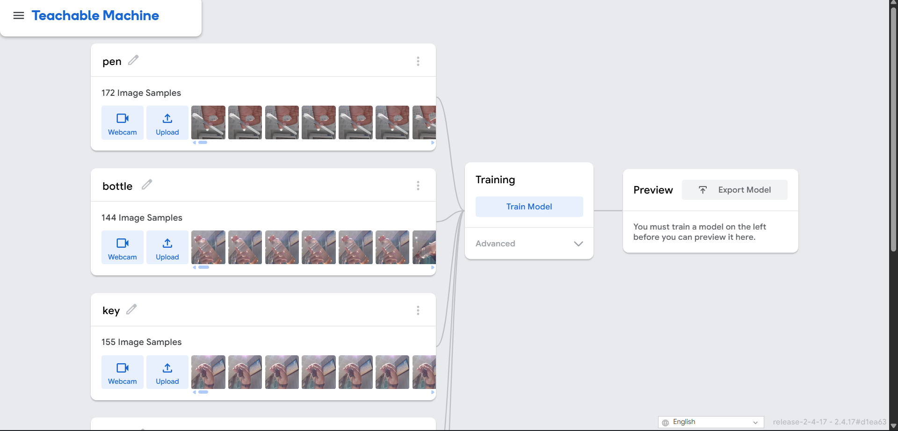
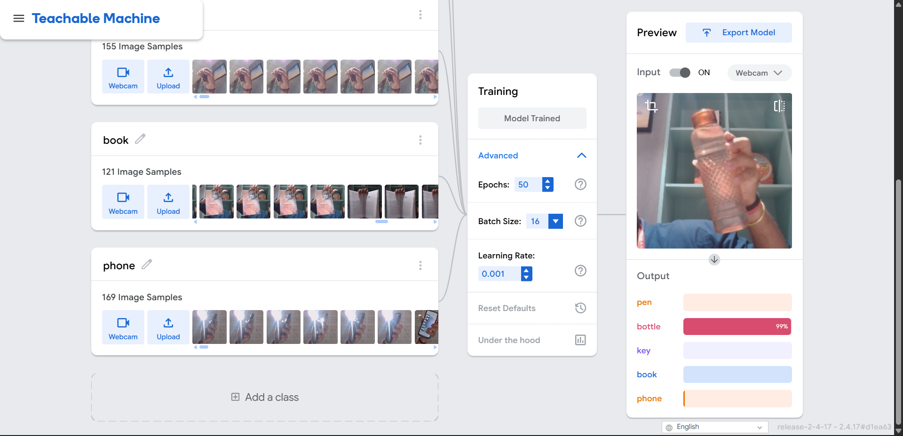
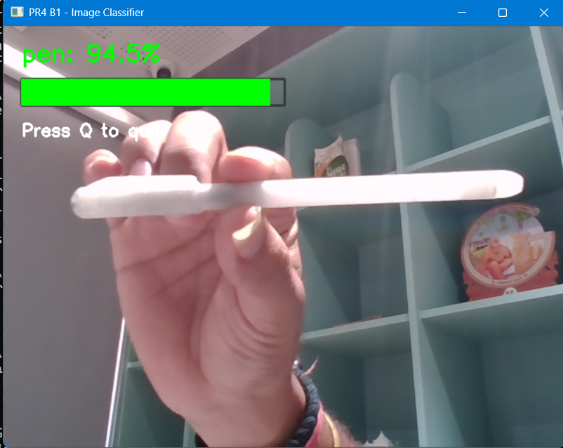
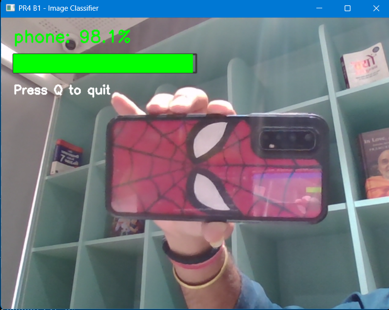
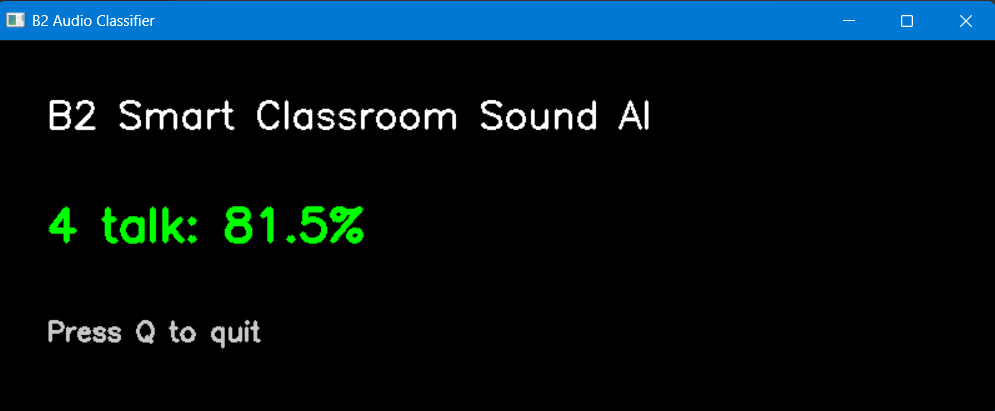
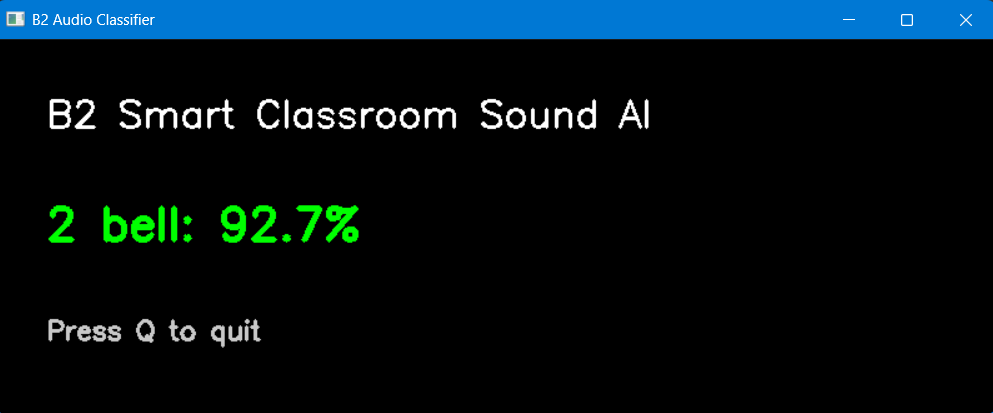
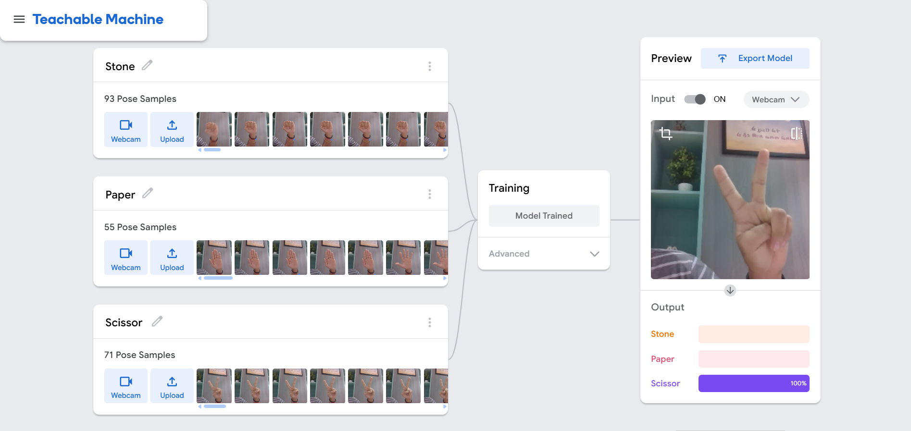
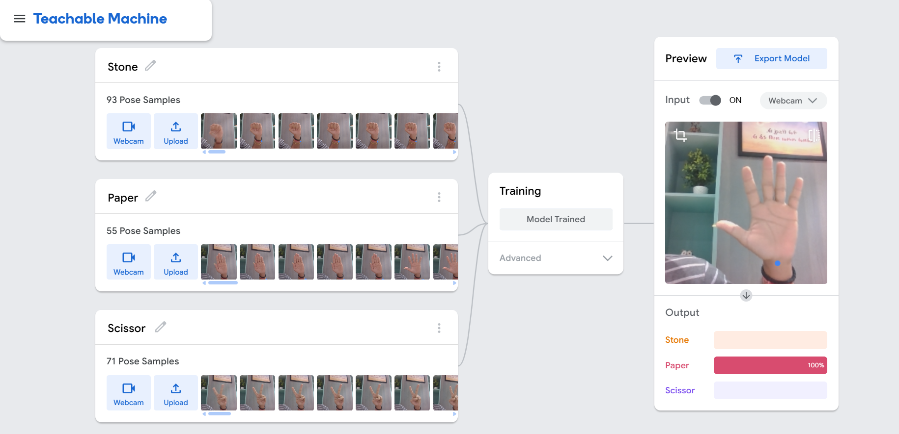
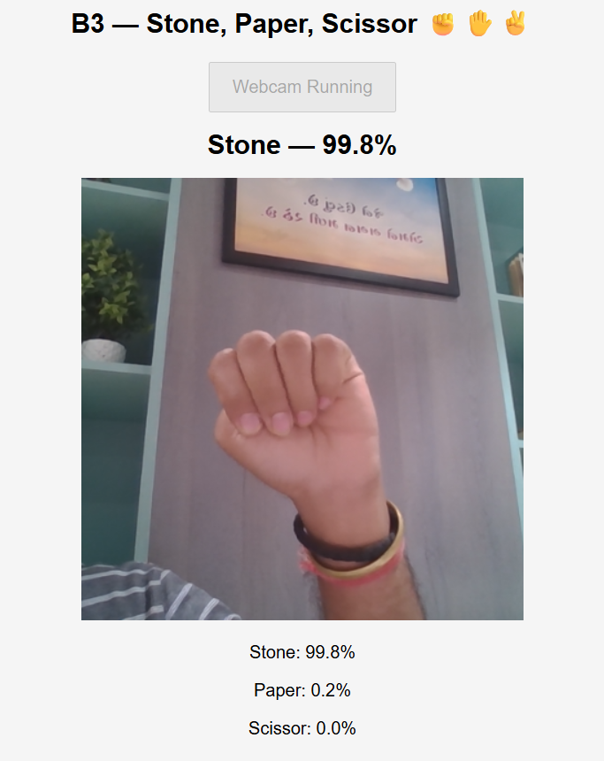
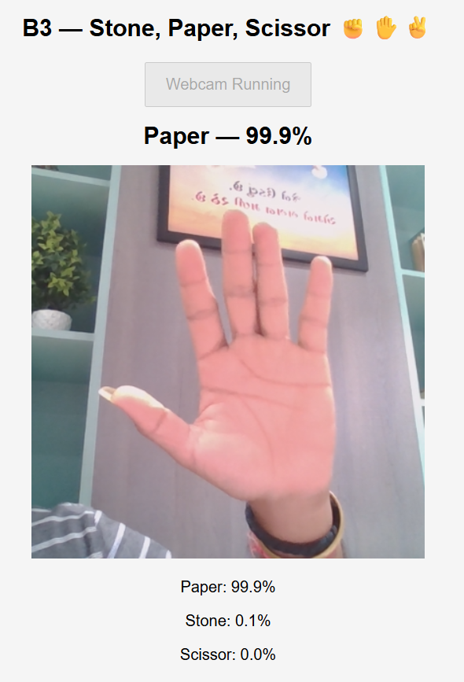

# 🧠 Deep Learning Practical Report 4 — Project B

<p align="center">
  <b>✨ Teachable Machine: Train, Export & Deploy</b><br>
  <i>Image Classification • Audio Classification • Pose Classification</i>
</p>

---

## 📌 Project Overview

This project explores **Teachable Machine** models and their deployment workflows using **Jupyter Notebook**. It contains three practical modules: an everyday-object image classifier, a smart-classroom sound classifier, and a Stone–Paper–Scissor pose experiment.

The repository includes notebooks, exported model files, and screenshots of training and testing evidence.

🎥 **Video:** [`Explanation Video`](https://drive.google.com/file/d/1dyl48J4srtE-wqF76ArJWylJC0tDCqZO/view?usp=sharing)
---

> ⚠️ **Current status:** B1 and B2 have exported models and Python notebook workflows. B3 model files are included, but its end-to-end live prediction flow still needs to be verified. See the B3 section below.

## 🧭 Project Modules

| Module | Project | Classes | Export format |
|---|---|---|---|
| 🖼️ **B1** | Everyday Object Classifier | Pen, Bottle, Phone, Book, Key | Keras `.h5` |
| 🎤 **B2** | Smart Classroom Sound Classifier | Background Noise, Clap, Talking, Keyboard, Bell | TensorFlow Lite `.tflite` |
| ✊ **B3** | Stone–Paper–Scissor Pose Experiment | Stone, Paper, Scissor | TensorFlow.js |

---

## 🖼️ B1 — Everyday Object Classifier

### 🎯 Objective
Recognize common objects from webcam frames using a Teachable Machine image model.

### 🏷️ Classes
- 🖊️ Pen
- 🍶 Bottle
- 📱 Phone
- 📖 Book
- 🔑 Key

### ⚙️ Workflow
1. Load the exported Keras model and class labels.
2. Capture frames from the webcam with OpenCV.
3. Resize images to **224 × 224** pixels.
4. Normalize pixel values to **`[-1, 1]`**.
5. Predict the object class and display the confidence score.

**Notebook:** [`B1 Obj Images/b1_image.ipynb`](B1%20Obj%20Images/b1_image.ipynb)  
**Model files:** `models/image/keras_model.h5`, `models/image/labels.txt`

### 📸 B1 — Training & Output Evidence

| Training | Model preview |
|---|---|
|  |  |

| Python output — example 1 | Python output — example 2 |
|---|---|
|  |  |

Additional B1 examples: `images/b1_preview2.png`, `images/b1_output3.png`, and `images/b1_output4.png`.

---

## 🎤 B2 — Smart Classroom Sound Classifier

### 🎯 Objective
Classify common classroom sounds from microphone recordings.

### 🏷️ Classes
- 🔇 Background Noise
- 👏 Clap
- 🗣️ Talking
- ⌨️ Keyboard
- 🔔 Bell

### ⚙️ Workflow
1. Load the exported TensorFlow Lite sound model and labels.
2. Record a short audio segment through the microphone.
3. Pass the recorded audio to the model using the notebook's inference workflow.
4. Display the predicted sound class and confidence.

**Notebook:** [`B2 Sound/b2_sound.ipynb`](B2%20Sound/b2_sound.ipynb)  
**Model files:** `models/audio/soundclassifier_with_metadata.tflite`, `models/audio/labels.txt`

### 📸 B2 — Prediction Evidence

| Audio prediction — example 1 | Audio prediction — example 2 |
|---|---|
|  |  |

---

## ✊ B3 — Stone, Paper, Scissor Pose Experiment

### 🎯 Objective
Explore a three-class Teachable Machine pose model using hand-sign labels.

### 🏷️ Classes
- ✊ Stone
- ✋ Paper
- ✌️ Scissor

**Notebook:** [`B3 Hand pose/b3_handpose.ipynb`](B3%20Hand%20pose/b3_handpose.ipynb)  
**Demo file:** [`B3 Hand pose/b3_pose_demo.html`](B3%20Hand%20pose/b3_pose_demo.html)  
**Model files:** `models/pose/model.json`, `models/pose/weights.bin`, `models/pose/metadata.json`

### ⚠️ Important model limitation
The exported model is **TensorFlow.js PoseNet format**, not a Keras `.h5` model. Do not rename these files to `.h5`. Teachable Machine's Pose Project focuses on body keypoints, so it may not reliably distinguish fine finger shapes such as Stone, Paper, and Scissor. Verify live predictions before marking B3 deployment as complete.

### 📸 B3 — Training & Output Evidence

| Training example 1 | Training example 2 |
|---|---|
|  |  |

| Output example 1 | Output example 2 |
|---|---|
|  |  |

Additional B3 output evidence: `images/b3_output3.png`.

---

## 🗂️ Repository Structure

```text
PR 4/
├── README.md
├── requirements.txt
├── B1 Obj Images/
│   └── b1_image.ipynb
├── B2 Sound/
│   └── b2_sound.ipynb
├── B3 Hand pose/
│   ├── b3_handpose.ipynb
│   └── b3_pose_demo.html
├── models/
│   ├── image/
│   │   ├── keras_model.h5
│   │   └── labels.txt
│   ├── audio/
│   │   ├── soundclassifier_with_metadata.tflite
│   │   └── labels.txt
│   └── pose/
│       ├── model.json
│       ├── weights.bin
│       └── metadata.json
└── images/
    └── training and output screenshots
```

## 🛠️ Requirements

- 🐍 Python **3.11** recommended
- 📓 Jupyter Notebook or JupyterLab
- 🧠 TensorFlow **2.15.1** for the B1 model workflow
- 📷 `opencv-python`
- 🔢 `numpy`
- 📊 `matplotlib`
- 🎙️ `sounddevice`
- 🧪 `scipy` (if needed by the audio notebook)

Install packages from a notebook cell if required:

```python
%pip install opencv-python numpy matplotlib sounddevice scipy tensorflow==2.15.1
```

After installation, restart the notebook kernel and run cells from the top. Keep in mind that package compatibility can depend on the active Jupyter kernel.

## ▶️ How to Run

1. 📦 Extract the ZIP archive.
2. 📂 Open the extracted `PR 4` folder in VS Code or Jupyter.
3. 📓 Open the notebook for the module you want to run.
4. 🧭 If a notebook uses an absolute `PROJECT_DIR`, update it to match your extracted folder.
5. ▶️ Run notebook cells from top to bottom.
6. 🎥 Allow webcam access for image/pose workflows and 🎙️ microphone access for audio workflows.
7. 🗃️ Keep each exported model in its matching subfolder under `models/`.

## ✅ Project Checklist

- [x] B1 image model exported
- [x] B1 model and labels included
- [x] B1 notebook included
- [x] B2 audio model exported
- [x] B2 TensorFlow Lite model and labels included
- [x] B2 notebook included
- [x] B3 model files and metadata included
- [x] B3 notebook and demo file included
- [x] Training/output screenshots included
- [ ] Verify B3 live predictions end-to-end
- [ ] Verify all notebooks run from a clean environment after updating paths
- [ ] Add a combined application if required by the course rubric

## 🧾 Notes

- 🖼️ Screenshots are embedded using relative paths. Keep the `images/` folder beside `README.md` so they display correctly on GitHub.
- 🔒 No model files have been renamed or converted by this README update.
- 📌 This README describes the contents of the provided project archive and does not claim that unfinished steps are complete.

---

<p align="center">
  Made with ❤️ for Deep Learning Practical Report 4
</p>
